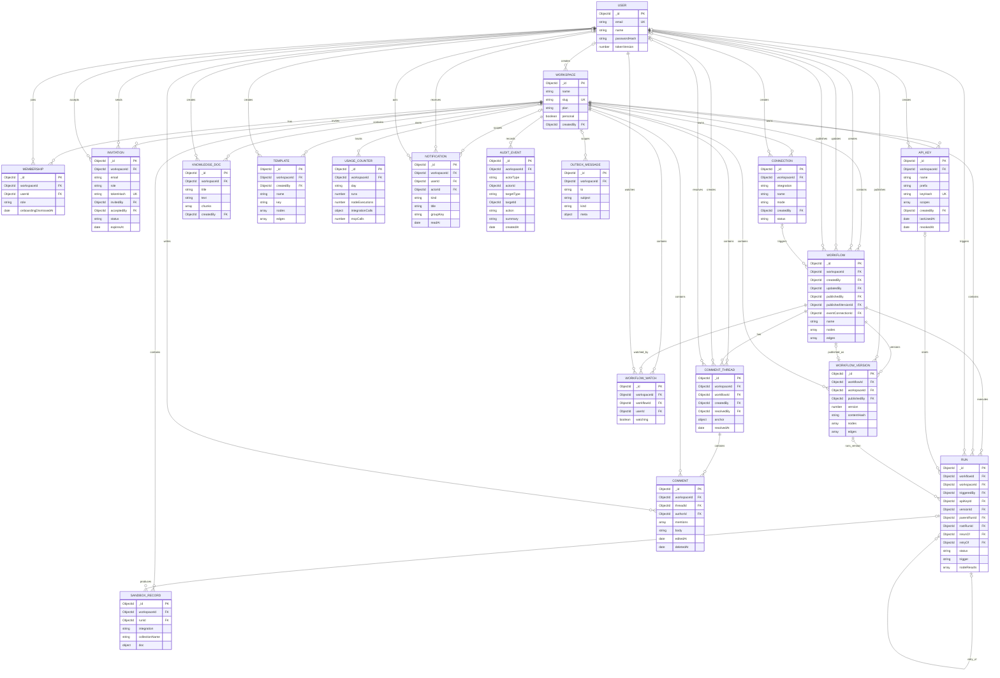

# AgentFlow model ER diagram

This diagram covers the Mongoose models in this directory. `PK` is MongoDB's
`_id`; `FK` marks an `ObjectId` reference declared by a model. MongoDB does not
enforce these references as relational foreign keys.

## Notes

- Fields marked `FK` are Mongoose `ref` paths except `AUDIT_EVENT.actorId` and
  `AUDIT_EVENT.targetId`, which are polymorphic IDs interpreted using
  `actorType`/`targetType`. `COMMENT.mentions` is an array of user IDs, not a
  populated `ref` path.
- `WORKFLOW.eventConnectionId` is the diagram label for
  `eventTrigger.connectionId`.
- `WORKFLOW.publishedVersionId` points to a version, while
  `WORKFLOW_VERSION.workflowId` points back to its workflow. The published
  pointer is optional and creates a cycle in the model references.
- Workflow graph nodes/edges, run node results, comment anchors, connection
  credentials, and several other nested values are embedded subdocuments or
  mixed data; they are shown as attributes rather than separate collections.
- `WORKSPACE.createdBy` is optional. A workspace's `personal` flag and
  membership lifecycle are application-level rules, not additional entity
  relationships.
